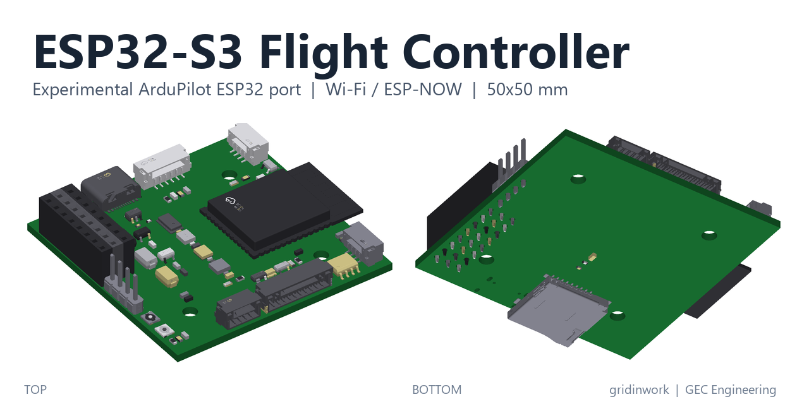
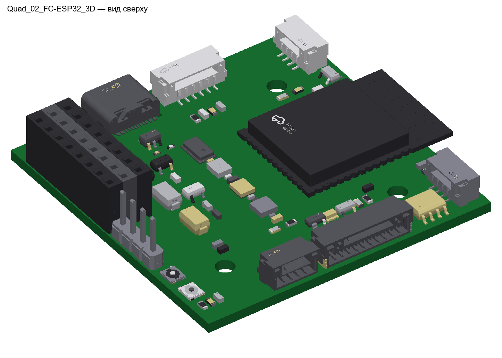
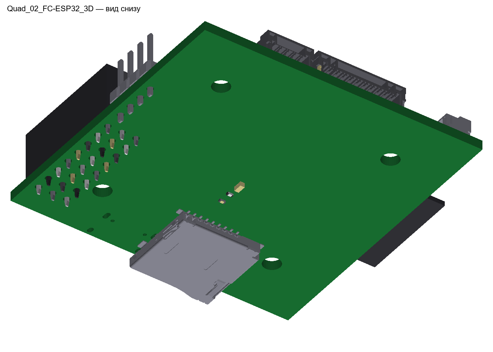
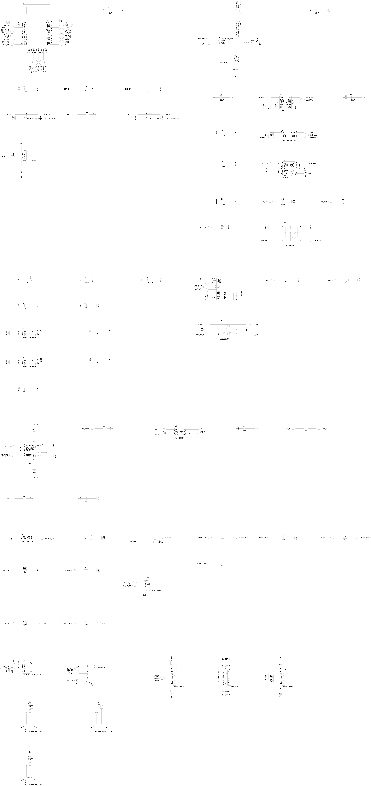
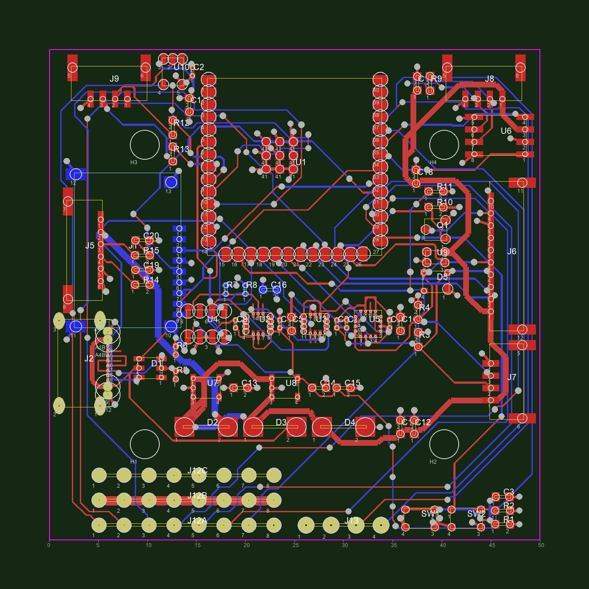

# ESP32-S3 Flight Controller (experimental)

Experimental **ESP32-S3** flight controller for the ArduPilot ESP32 port. It carries the same sensor set as the [STM32H743 flight controller](https://github.com/gridinwork/STM32H743-Flight-Controller-ArduPilot), so the two platforms can be compared on identical sensors, and it doubles as a Wi-Fi / ESP-NOW MAVLink bridge to a tablet. **50 x 50 mm**, 4-layer PCB.

It is a test bench for small quadcopters and drone research: the ArduPilot ESP32 port is still experimental (no DShot, no SD logging yet), so this board is **not meant for a working aircraft** for now.

## Highlights

| Block | Part |
|---|---|
| Module | ESP32-S3-WROOM-1-N16 (alternative: N16R2; not R8 - Octal PSRAM uses IO35-37) |
| IMU 1 / IMU 2 / barometer | IIM-42652, BMI270, MS5611 on one SPI bus (FSPI), three chip selects |
| Compass | IST8310 on I2C0, shared with an external GPS compass and an INA226 |
| CAN | TJA1051T/3 (TWAI) |
| Storage | microSD (SDMMC, 1-bit) |
| USB | USB-C on GPIO19/20 with USBLC6-2SC6 |
| Power | 2 x XC6220 3.3 V (module >= 1 A, sensors) |

34 GPIOs are used; strapping-pin restrictions and what was sacrificed compared with the STM32 board are documented in `docs/Pinmap_FC-ESP32.md` (Russian).

## Status (work in progress)

- Schematic complete and checked against the pin map.
- PCB: placed, **routing is not finished**, copper pours and DRC are not done.
- **No firmware is included** - the ArduPilot ESP32 port has not been built for this board yet.
- The board has not been manufactured or tested.

## Gallery

| 3D (top) | 3D (bottom) |
|---|---|
|  |  |

| Schematic | PCB layout (current state) |
|---|---|
|  |  |

## Repository layout

| Path | Content |
|---|---|
| `hardware/EasyEDA/` | EasyEDA Pro project (`.epro2`), schematic and PCB PDF/PNG, 3D STEP model with components, netlist, BOM and CPL (JLCPCB format) |
| `images/` | 3D renders (top/bottom), schematic and PCB previews |
| `docs/` | Design documentation: requirements, pin map, BOM notes, full board description (**written in Russian**) |

## How to open the design

1. Install [EasyEDA Pro](https://pro.easyeda.com/) (free).
2. *File -> Import -> EasyEDA Pro* and select `hardware/EasyEDA/Quad_02_FC-ESP32.epro2`.
3. The 3D model (`*_3D.step`) opens in any CAD (SolidWorks, Fusion, FreeCAD, Blender with a STEP importer).

## Bill of materials

Parts are chosen from the LCSC/JLCPCB catalogue (LCSC numbers are in `hardware/EasyEDA/*_BOM.xlsx` and `docs/BOM.md`). Stock levels change daily - **re-check availability before ordering**. `*_CPL.xlsx` is the pick-and-place file for JLCPCB assembly.

## License

Hardware (schematic, PCB, 3D model, documentation): **CERN-OHL-P-2.0** (see `LICENSE`).

Part of the [DIY Quadcopter Hardware](https://github.com/gridinwork/DIY-Quadcopter-Hardware) project by Oleg Gridin, GEC Engineering.
